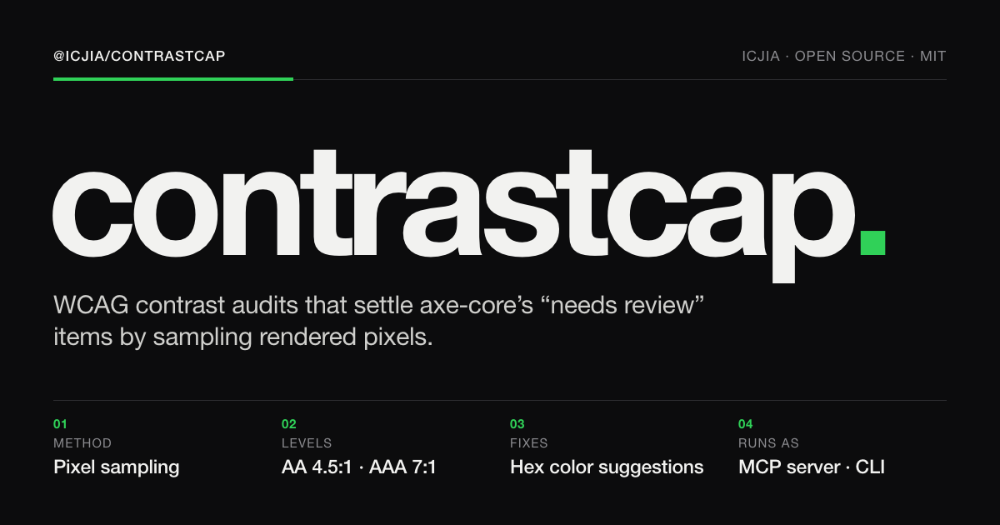

# @icjia/contrastcap

[](https://www.npmjs.com/package/@icjia/contrastcap)
[](LICENSE)


**MCP server and command-line tool for automated WCAG contrast auditing via pixel-level analysis.**

`contrastcap` resolves the "needs review" gap that axe-core and SiteImprove leave behind. When text sits over a complex background (gradient, image, semi-transparent overlay), axe can't determine the rendered contrast ratio from the DOM alone and marks the element `incomplete`. `contrastcap` loads the page in headless Chromium, screenshots the element region with the text hidden, samples actual rendered pixels, and returns a decisive pass / fail / warning with a concrete hex color suggestion for failures.

Built for the same triage workflow as `@icjia/lightcap` and `@icjia/viewcap` — stdio transport, ESM, minimal token footprint, `get_status` tool, `publish.sh`.

**New in 0.2: a full `contrastcap` CLI.** It does everything the MCP server does, so Claude (or any coding agent) can run contrast audits from the shell without the MCP server installed. See [MCP or CLI?](#mcp-or-cli) and [How language models use the CLI](#how-language-models-use-the-cli).

---

## MCP or CLI?

contrastcap runs two ways, and both return **the same JSON** from the same code (`src/tools/*`):

- **MCP server**: Claude calls `get_contrast_summary`, `check_page_contrast`, `check_element_contrast` and `get_status` directly. Registering it means a server process is started for every session, and the client has to load its tool definitions (Claude Code loads them on demand; some clients load every definition up front).
- **CLI**: Claude (or you) runs `contrastcap summary <url>` through the shell. No server registration and nothing running between audits. It works the same on macOS and Linux, and in any agent that can run shell commands.

You can run both, or uninstall the MCP server and rely on the CLI alone (see [Using the CLI instead of the MCP server](#using-the-cli-instead-of-the-mcp-server)).

### Why the CLI exists

contrastcap started as an MCP server, and that's still a great way to run it. But a registered MCP server has a standing cost, and how big it is depends on the client:

- **Clients that load every tool definition up front** send all four tools, with their schemas and descriptions, to the model in every session, whether or not you check contrast that day.
- **Claude Code** defers MCP tool definitions: until a tool is needed, the model sees little more than its name. So in Claude Code the token saving from dropping the server is small.

What doesn't depend on the client: a registered server starts a process with every session, and it only works in MCP clients. The CLI has neither cost. It is the same code returning the same JSON, run as a shell command only when an audit is needed, in any agent that has a shell (Claude Code, Codex, Cursor's agent, Aider) or in a script or CI job.

### Feature parity

Everything the MCP server does, the CLI does too, as of v0.2.0.

| Capability | MCP tool / parameter | CLI command / flag |
|---|---|---|
| Summary counts (cheapest) | `get_contrast_summary` | `contrastcap summary <url>` |
| Full page audit with hex fixes | `check_page_contrast` | `contrastcap page <url>` |
| Single element by selector | `check_element_contrast` | `contrastcap element <url> <selector>` |
| WCAG level | `level: "AA" \| "AAA"` | `-l, --level AA\|AAA` (all three commands) |
| Itemize passing elements | `include_passes` (reserved, currently no effect) | not needed until it does something |
| Versions + update check | `get_status` | `contrastcap status` (or `contrastcap --version`) |
| Logging | `--verbose` / `--quiet` server args | `--verbose` / `--quiet` (any position) |
| Environment variables | `CONTRASTCAP_*` (timeouts, viewport, level, limits) | same variables, same effect |

**Known differences** (none affect results):

- **Browser lifetime:** the MCP server keeps Chromium running between calls; the CLI launches it for each command and closes it afterwards, so each CLI call takes about a second longer.
- **Concurrency:** the MCP server queues up to `CONTRASTCAP_MAX_CONCURRENT` audits per process. Each CLI call is its own process.
- The CLI writes progress logs (`[contrastcap] ...`) to stderr. Add `--quiet` to keep Claude's Bash output down to the JSON itself.
- URL validation, SSRF controls (`CONTRASTCAP_BLOCK_PRIVATE`), selector validation, timeouts and error sanitization are shared code, so the two modes enforce exactly the same limits.

---

## Install

```bash
pnpm install
# Playwright's Chromium is fetched automatically via postinstall.
# If that fails (offline, CI), run manually:
pnpm exec playwright install chromium
```

Requires Node 20+.

## Claude Desktop / Claude Code configuration

Add to `claude_desktop_config.json` (or your IDE's MCP config):

```json
{
  "mcpServers": {
    "contrastcap": {
      "command": "npx",
      "args": ["-y", "@icjia/contrastcap"]
    }
  }
}
```

Or, pointing at a local checkout:

```json
{
  "mcpServers": {
    "contrastcap": {
      "command": "node",
      "args": ["/absolute/path/to/contrastcap-mcp/src/server.js"]
    }
  }
}
```

Restart Claude to pick up the new server.

---

## Tools

All four tools default to **WCAG AA**. `AAA` must be explicitly requested via `level: "AAA"`.

### `get_contrast_summary`

Counts only — the cheapest token footprint. Use this first to decide whether a full audit is warranted.

```json
{ "url": "https://example.com/about" }
```

Returns:

```json
{
  "url": "https://example.com/about",
  "timestamp": "2026-04-13T14:30:00Z",
  "wcag_level": "AA",
  "counts": {
    "total_elements_checked": 52,
    "pass": 47,
    "fail": 3,
    "warning": 2,
    "skipped": 0
  }
}
```

### `check_page_contrast`

Full page audit. Returns detail for failures and warnings only — passing elements are counted, not itemized.

```json
{ "url": "https://example.com/about", "level": "AA" }
```

Returns:

```json
{
  "url": "...",
  "timestamp": "...",
  "wcag_level": "AA",
  "summary": { "total": 52, "pass": 47, "fail": 3, "warning": 2, "skipped": 0 },
  "failures": [
    {
      "selector": "nav.main-nav > ul > li:nth-child(3) > a",
      "text": "Grant Opportunities",
      "ratio": 3.21,
      "required": 4.5,
      "level": "AA",
      "fontSize": "14px",
      "fontWeight": "400",
      "isLargeText": false,
      "foreground": "#6c757d",
      "background": "#e9ecef",
      "backgroundSource": "pixel-sample",
      "suggestion": "#595f64"
    }
  ],
  "warnings": [
    {
      "selector": ".hero-banner h1",
      "text": "Criminal Justice Information…",
      "ratio": 4.62,
      "required": 4.5,
      "level": "AA",
      "foreground": "#ffffff",
      "background": "#5a7a91",
      "backgroundSource": "pixel-sample-over-image",
      "note": "Ratio within 0.3 of threshold — marginal. Background sampled from gradient or image — may vary at other positions."
    }
  ]
}
```

**Suggestion format is always hex** (e.g. `"#595f64"`). The caller formats prose.

### `check_element_contrast`

Single-element check. Use this to verify a fix without re-running the full page audit.

```json
{
  "url": "http://localhost:3000/about",
  "selector": "nav.main-nav > ul > li:nth-child(3) > a"
}
```

Returns a single-element object with `pass: true|false`, the measured `ratio`, `foreground`, `background`, and a `suggestion` hex if failing.

### `get_status`

Server + axe-core + Playwright versions, plus a non-blocking npm update check.

---

## How it works

1. Playwright navigates to the URL (30s timeout, `networkidle` fallback to `load`).
2. The server re-validates `page.url()` against the SSRF denylist (redirect guard).
3. axe-core is injected via CDP `Runtime.evaluate` (exempt from page CSP) and run with the level-appropriate rule: `color-contrast` (AA, 1.4.3) or `color-contrast-enhanced` (AAA, 1.4.6). Its `violations` (definite failures) and ratio-carrying `passes` are trusted as-is. Passes **without** a computed ratio are not trusted — the enhanced rule files indeterminate backgrounds there instead of under `incomplete` — and are re-resolved like needs-review nodes.
4. For every `incomplete` (needs-review) node — plus any ratio-less pass:
   - Scroll into view
   - Read computed `color`, `fontSize` (always resolved to px), `fontWeight`
   - Save the element's prior inline `color`, set it to `transparent`, screenshot the bounding box, then restore
   - Decode pixels via `sharp`, sample on a 5×3 grid
   - If per-channel stddev > 15, treat as gradient/image and use worst-case pixel (darkest on light text, lightest on dark text)
   - Otherwise take the median per channel
   - Compute the WCAG 2.1 ratio and compare against the required threshold
5. For failures, compute a hex color suggestion via 16-iteration HSL-lightness binary search in both directions; return whichever candidate has the smaller `|ΔL|` from the original foreground.
6. Passes bump the `pass` count. Marginal passes or high-variance backgrounds are flagged as warnings, not failures.

### Limits & timeouts

| Scope | Limit |
|-------|-------|
| Page navigation | 30 s |
| Per-element pixel sampling | 5 s (skipped on timeout, audit continues) |
| Total audit | 120 s (returns `Audit timed out`) |
| Max elements pixel-sampled per page | 200 |
| Concurrent audits per process | 2 (queue-full error beyond that) |

### What's out of scope (v1)

- Authenticated pages (no cookie/session handling)
- Multi-page crawling (use `a11yscan` for that)
- Focus/hover state contrast
- Dark-mode toggling
- Non-text contrast (UI components, graphical objects)
- Elements inside shadow DOM or cross-origin iframes (counted under `skipped`)
- PDF contrast

---

## Environment variables

| Variable | Default | Purpose |
|----------|---------|---------|
| `CONTRASTCAP_NAV_TIMEOUT` | `30000` | Page navigation timeout (ms) |
| `CONTRASTCAP_ELEMENT_TIMEOUT` | `5000` | Per-element pixel sampling timeout (ms) |
| `CONTRASTCAP_AUDIT_TIMEOUT` | `120000` | Total audit cap (ms) |
| `CONTRASTCAP_LEVEL` | `AA` | Default WCAG level (`AA` or `AAA`) |
| `CONTRASTCAP_MAX_ELEMENTS` | `200` | Max elements to pixel-sample per page |
| `CONTRASTCAP_MAX_CONCURRENT` | `2` | Max concurrent audits per process |
| `CONTRASTCAP_VIEWPORT_WIDTH` | `1280` | Chromium viewport width |
| `CONTRASTCAP_VIEWPORT_HEIGHT` | `800` | Chromium viewport height |
| `CONTRASTCAP_BLOCK_PRIVATE` | unset | Set to `1` to block RFC1918 / loopback / CGNAT addresses (production hardening). See **Security**. |
| `PLAYWRIGHT_SKIP_BROWSER_DOWNLOAD` | unset | Set to `1` to skip the Chromium download in `postinstall` (offline / air-gapped installs). |
| `PLAYWRIGHT_DOWNLOAD_HOST` | unset | Mirror host for Playwright's Chromium download. |

---

## CLI

### Install the CLI from a clone (macOS + Linux)

```bash
git clone https://github.com/ICJIA/contrastcap-mcp.git
cd contrastcap-mcp
./install-cli.sh
source ~/.zshrc     # or ~/.bashrc, or open a new terminal
```

`install-cli.sh` is safe to re-run (after a `git pull`, for example). It:

1. Checks for Node 20+ and installs dependencies with **pnpm** (this repo's package manager; it falls back to npm if pnpm isn't installed), then downloads Playwright's Chromium.
2. Adds a `contrastcap` alias to `~/.zshrc` (and to `~/.bashrc` if you have one or bash is your login shell). The alias sits between `# >>> contrastcap cli >>>` markers, so re-running replaces it instead of duplicating it.
3. Symlinks `~/.local/bin/contrastcap` to `src/cli.js`. Aliases only load in interactive shells, so the symlink is what lets **Claude Code's Bash tool**, scripts and cron find `contrastcap`. If `~/.local/bin` isn't on your `PATH`, the script tells you what to add.
4. Runs a test audit against a tiny page it serves on localhost, to prove the browser launches. On Linux, if Chromium is missing system libraries, it prints the `playwright install-deps` command to run.

To remove the alias and symlink: `./install-cli.sh --uninstall`.

Prefer npm? `npm install -g @icjia/contrastcap` installs the same `contrastcap` command (no alias needed).

### Using the CLI instead of the MCP server

1. Install the CLI (above) and check it: `contrastcap status`.
2. Remove the MCP server registration:

   ```bash
   claude mcp remove contrastcap -s user     # or -s project / -s local, wherever you added it
   ```

3. Tell Claude about the CLI. Add this to `~/.claude/CLAUDE.md` (or a project `CLAUDE.md`):

   ```markdown
   - For WCAG contrast audits, use the `contrastcap` CLI via Bash (the MCP server is not installed):
     `contrastcap --quiet summary <url>` first, then `contrastcap --quiet page <url>` for detail,
     `contrastcap --quiet element <url> <selector>` to verify a fix. Add `--level AAA` when asked.
     Output is JSON with hex color suggestions for failures.
   ```

### How language models use the CLI

Once `contrastcap` is on your `PATH` (or aliased), a model uses it exactly the way you would: it runs the command in its shell tool and reads the JSON from stdout. There is nothing to register. The model only needs to know the command exists, which is what the `CLAUDE.md` / `AGENTS.md` note above is for.

A typical session, with the commands the model runs on its own:

```bash
contrastcap --quiet summary http://localhost:3000                  # how bad is it?
contrastcap --quiet page http://localhost:3000                     # which elements, which fixes
contrastcap --quiet element http://localhost:3000 'nav a'          # after editing the CSS
contrastcap --quiet page http://localhost:3000 --level AAA         # only when AAA is requested
```

What comes back is the same JSON the MCP tools return. For a failing element:

```json
{
  "url": "http://localhost:3000/",
  "wcag_level": "AA",
  "selector": "h1",
  "text": "Low contrast heading",
  "ratio": 2.85,
  "required": 3,
  "pass": false,
  "fontSize": "32px",
  "fontWeight": "700",
  "isLargeText": true,
  "foreground": "#999999",
  "background": "#ffffff",
  "backgroundSource": "pixel-sample",
  "suggestion": "#949494"
}
```

From there the model runs the usual loop: summary → page detail → edit the color → `element` to confirm the fix → summary again.

Tips for agents:

- **Start with `summary`.** It's the cheapest call; only ask for `page` detail when there are failures or warnings.
- **Use `--quiet`.** It keeps progress logs off stderr, so the model's context only holds the JSON.
- **Exit codes:** `0` on success, `1` on any error, with a single readable `Error: ...` line.
- **Other agents:** put the same note in whatever file your agent reads: `AGENTS.md` (Codex and others), `.cursor/rules`, `CONVENTIONS.md` (Aider), and so on.

### Setting up the alias by hand (zsh and bash)

`install-cli.sh` does this for you. To do it yourself, point an alias at `src/cli.js` in your clone. Replace `/path/to/contrastcap-mcp` with the real path.

**zsh** (the default shell on macOS):

```bash
echo "alias contrastcap='node \"/path/to/contrastcap-mcp/src/cli.js\"'" >> ~/.zshrc
source ~/.zshrc
contrastcap --version
```

**bash** (the usual default on Linux):

```bash
echo "alias contrastcap='node \"/path/to/contrastcap-mcp/src/cli.js\"'" >> ~/.bashrc
source ~/.bashrc
contrastcap --version
```

On macOS, bash login shells read `~/.bash_profile` rather than `~/.bashrc`. If the alias doesn't appear in a new Terminal window, add `[ -f ~/.bashrc ] && . ~/.bashrc` to `~/.bash_profile`.

**Aliases vs. agents.** Shells only expand aliases in *interactive* sessions. A coding agent's shell tool may run commands non-interactively and never see the alias. That's why `install-cli.sh` also puts a real executable on your `PATH`. To do that by hand:

```bash
mkdir -p ~/.local/bin
ln -sf "/path/to/contrastcap-mcp/src/cli.js" ~/.local/bin/contrastcap
chmod +x "/path/to/contrastcap-mcp/src/cli.js"
command -v contrastcap    # should print ~/.local/bin/contrastcap
```

(`~/.local/bin` must be on your `PATH`. Add `export PATH="$HOME/.local/bin:$PATH"` to your `~/.zshrc` or `~/.bashrc` if it isn't.) `npm install -g @icjia/contrastcap` achieves the same thing without a clone.

### Commands

```bash
contrastcap summary  https://example.com/about                 # counts only (lowest cost)
contrastcap page     https://example.com/about --level AAA     # failures + warnings with hex fixes
contrastcap element  http://localhost:3000 'nav a'             # one element
contrastcap status                                             # versions + npm update check
contrastcap --version                                          # contrastcap v0.2.0 (axe-core v4.x.x)
contrastcap --quiet page http://localhost:3000                 # JSON only, no progress logs
contrastcap --verbose summary http://localhost:3000            # flag position doesn't matter
```

Without installing anything: `npx @icjia/contrastcap summary <url>`.

The exit code is `1` on any error, so `contrastcap` also works in scripts and CI.

Run with no arguments, `contrastcap` starts the MCP server. MCP clients always launch it that way, with stdin piped. If you type plain `contrastcap` at a terminal, it prints help instead of sitting there waiting for JSON-RPC. The help starts with the contrastcap and axe-core versions, then lists the commands, examples and global flags.

---

## Publishing

`./publish.sh` mirrors the pattern used by `@icjia/lightcap` and `@icjia/viewcap`:

```bash
./publish.sh              # bump patch version and publish (default)
./publish.sh minor        # bump minor version and publish
./publish.sh major        # bump major version and publish
./publish.sh patch 123456 # bump + publish with an npm 2FA code (skips the y/N prompt)
./publish.sh --dry-run    # dry run only, no publish
```

A 2FA code must be 6–8 digits; anything else (such as a misplaced `--dry-run`) stops the script before it changes anything. Every release needs a `CHANGELOG.md` entry for the new version.

First-time publish is auto-detected (no existing version on npm) — the current `package.json` version is used as-is. Subsequent releases bump + tag + push.

---

## Security

### Threat model

`contrastcap` is an MCP server invoked by an LLM that may be acting on prompt-injected, attacker-controlled content. The dangerous tools are `check_page_contrast` and `check_element_contrast` — both accept a URL and load it in headless Chromium. A malicious URL could attempt to pivot to internal network resources (SSRF), exfiltrate page content via element text, or load adversarial schemes (`file:`, `javascript:`, `data:`).

### Controls

- **Scheme allowlist**: `http:` and `https:` only. `file:`, `javascript:`, `data:`, `ftp:`, etc. are rejected with a generic `Blocked URL scheme` error.
- **Cloud-metadata blocklist** (always on): `169.254.169.254`, `metadata.google.internal`, `metadata.azure.com`, `0.0.0.0`.
- **CIDR-classified IP blocking** (always on): IPv4 link-local (`169.254.0.0/16`), IPv6 link-local (`fe80::/10`), IPv6 unspecified (`::`), IPv4 multicast/reserved (`224.0.0.0/4`+), IPv6 multicast (`ff00::/8`). IPv4-mapped IPv6 addresses are unwrapped first so `::ffff:169.254.169.254` is recognized as link-local. DNS-resolution failures fail closed.
- **Optional private-IP blocking**: set `CONTRASTCAP_BLOCK_PRIVATE=1` to also block RFC1918 (`10/8`, `172.16/12`, `192.168/16`), CGNAT (`100.64/10`), loopback (`127/8`, `::1`), and IPv6 ULA (`fc00::/7`). Off by default — the primary use case is auditing dev servers — but **strongly recommended** when running the server in a trusted internal network where the LLM should not be able to pivot to internal services via prompt injection.
- **Post-navigation re-check**: after `page.goto` settles, `page.url()` is re-validated against the same SSRF policy. This catches `http://attacker.com/redirect` → `http://10.0.0.5/admin`.
- **Selector hardening**: `check_element_contrast` rejects Playwright engine prefixes (`xpath=`, `text=`, `role=`, `internal:*`, `_react=`, `_vue=`, etc.) and chain operators (`>>`). Only plain CSS selectors are accepted, so a malicious selector cannot pivot to XPath / text-content matching to read arbitrary DOM text.
- **Generic error messages** — no filesystem paths or stack traces are returned to MCP clients.
- **No file writes.** Screenshots are in-memory buffers consumed by `sharp` and discarded.
- **Hardened postinstall**: Playwright's CLI is resolved through Node's module resolver (`require.resolve`) rather than `$PATH`, so a shadowed `playwright` binary cannot hijack the install. Chromium download can be skipped (`PLAYWRIGHT_SKIP_BROWSER_DOWNLOAD=1`) or mirrored (`PLAYWRIGHT_DOWNLOAD_HOST`). If Chromium is missing at runtime, the launcher emits an actionable error rather than a Playwright-internal stack trace.

### Audit history

A red/blue team audit covering the MCP tool surface, Playwright/browser launch, dependency posture, and publish pipeline was performed in 0.1.4 (see CHANGELOG). `pnpm audit` is clean (0 vulnerabilities across all dependencies).

---

## License

MIT © 2026 Illinois Criminal Justice Information Authority (ICJIA)
